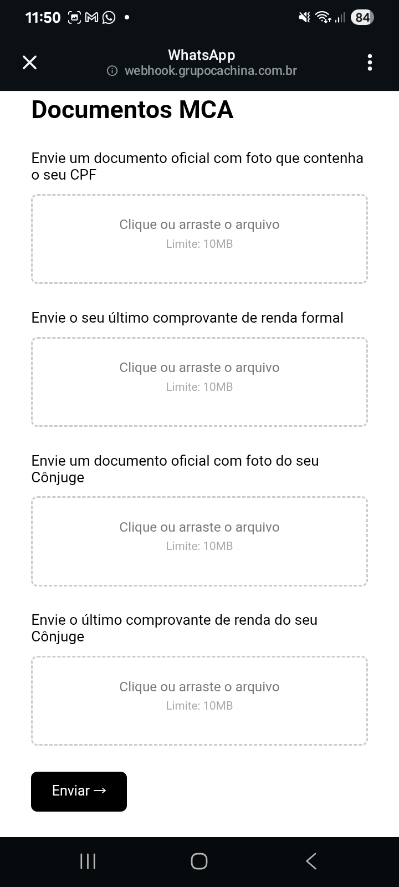
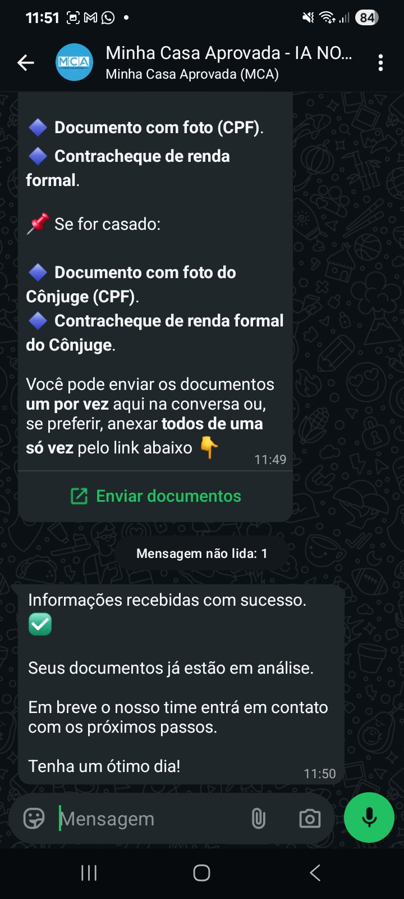
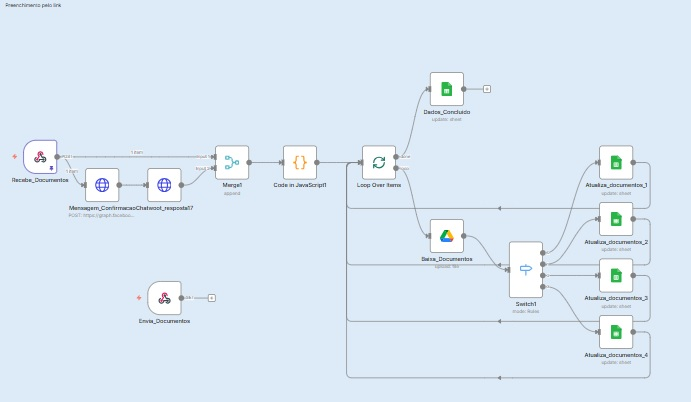
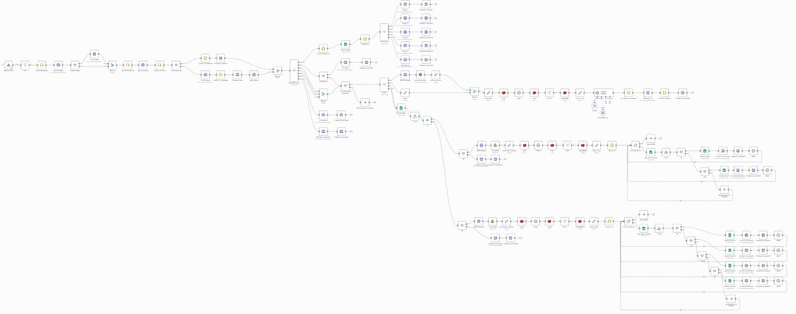

# 🤖 Assistente Virtual Inteligente & Pré-Análise de Crédito Imobiliário (MCA)

> Automatização inteligente de ponta a ponta para qualificação de leads, simulação de financiamento habitacional e gestão documental integrada via WhatsApp e n8n.

---

## 🚀 Sobre o Projeto

Este projeto consiste em um **assistente virtual inteligente de atendimento e pré-análise de crédito** desenvolvido para o setor imobiliário (Minha Casa Aprovada - MCA). A solução automatiza o primeiro contato com o cliente via WhatsApp, conduz uma coleta de dados estruturada por meio de formulários web integrados, realiza cálculos preditivos de subsídios/financiamento e gerencia o envio e armazenamento seguro de documentos.

O sistema foi orquestrado utilizando **n8n** como motor de fluxos de automação, integrando APIs de mensageria, processamento de dados em JavaScript, salvamento automatizado em planilhas/bancos de dados e armazenamento em nuvem.

---

## ✨ Funcionalidades Principais

- **💬 Atendimento Automatizado via WhatsApp:** Recepção instantânea de leads, qualificação inicial e direcionamento humanizado ou automatizado.
- **📋 Formulários Dinâmicos de Pré-Análise:** Coleta de dados cadastrais, renda formal/informal, estado civil e FGTS de forma fluida através de interfaces web customizadas.
- **📊 Simulação Instantânea de Financiamento:** Cálculo automatizado com base na localização e renda do lead, estimando valores de imóveis, capacidade de financiamento e subsídios potenciais.
- **📁 Portal de Envio de Documentos:** Interface web integrada para upload seguro de documentos oficiais (CPF, comprovantes de renda) do titular e cônjuge, com confirmação de sucesso em tempo real.
- **⚙️ Orquestração de Dados:** Manipulação avançada de dados com nós de código em JavaScript, rotas condicionais (`Switch`) e laços de repetição (`Loop Over Items`) para atualização de registros.

---

## 🛠️ Tecnologias e Ferramentas

-  **n8n:** Orquestração de fluxos de automação e webhooks.
-  **JavaScript:** Manipulação e tratamento de payloads e dados complexos.
-  **Docker:** Containerização e ambiente de execução dos serviços.
-  **Google Sheets / Drive:** Armazenamento estruturado de dados e gestão de arquivos enviados.
-  **Meta WhatsApp Business Cloud API:** Canal de comunicação direta com o cliente.

---

## 📷 Demonstração do Fluxo (Prints da Aplicação)

### 1. Interação Inicial & Formulário de Pré-Análise no WhatsApp
O fluxo recepciona o usuário no WhatsApp e disponibiliza um formulário interativo para coleta de dados de crédito.

<p align="center">
  
  
</p>

### 2. Simulação de Financiamento & Gestão de Documentos
Após o preenchimento, o sistema calcula o potencial de financiamento/subsídio e direciona o usuário para o envio seguro de documentos.

<p align="center">
  
  
  
  
  
</p>

---

## 📐 Arquitetura do Fluxo (n8n)

A solução é dividida em módulos robustos de automação que processam a entrada de dados, realizam o tratamento lógico e atualizam os registros de forma assíncrona:

- **Módulo de Entrada:** Recepção de requisições via webhook de formulários e mensagens do WhatsApp.
- **Módulo de Processamento:** Blocos de código em JavaScript e condicionais (`Switch`) para qualificação de perfis.
- **Módulo de Saída e Armazenamento:** Atualização de planilhas de controle e salvamento de arquivos no Google Drive.

<p align="center">
  
  
</p>

---

## 🚀 Como Executar o Projeto

1. **Clone o repositório:**
   ```bash
   git clone [https://github.com/GabrielCDL/nome-do-repositorio.git](https://github.com/GabrielCDL/nome-do-repositorio.git)
